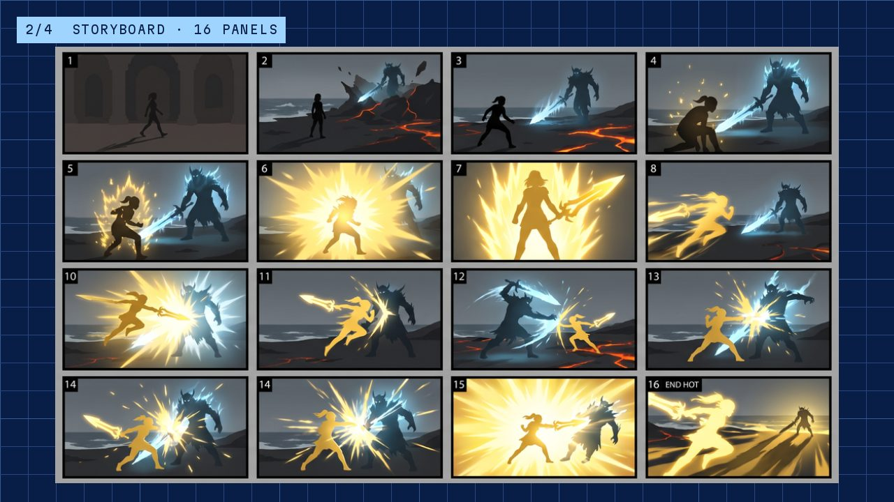
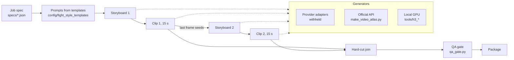

# action-sequence-pipeline

**A pipeline that turns a short job spec into a finished 30-second action sequence: storyboards,
two generated clips joined on a bridge frame, a local vision-model QA gate, and a package, with
original characters only.**

[](https://mhfx.ai/systems/action-sequence-pipeline/)

- **Spec in, sequence out.** A job spec names a heroine, an opponent, a fight style, a palette,
  and an environment. `make_video.js` builds the storyboards and both clips, joins them, scores the
  result, and writes a resumable state file after every stage.
- **Gates instead of eyeballs.** Local vision and face models check each render: right cast on
  screen, no storyboard frames leaking into the video, no frozen or half-rate frames, and a
  five-axis quality score. A self-test proves the gates still reproduce their calibrated verdicts.
- **Local GPU or hosted.** The same stages run through a local video model on one GPU (an
  overnight queue under a GPU lock) or through an official generation API.

This is a curated public snapshot of a private working repo. Browser adapters for hosted services,
the nightly planner, and the prompt library are **withheld**. Each has a short note where it would
sit. See [What is withheld](#what-is-withheld).

## Pipeline



The two clips are joined with a **bridge**: clip 2's storyboard starts from clip 1's last frame, so
the cut lands on matching action.

## Repo map

| Path | What it is |
|---|---|
| `make_video.js` | Orchestrator: spec → storyboards → clips → join → QA → package. Validates the spec and renders every prompt before any generation (`--validate-only`). |
| `qa_gate.py` | Local vision-model gate. Five axes: character consistency, readability, artifacts, energy arc, seam quality. Calibrated against must-pass and must-fail videos (results in the header). |
| `atlas_cloud.py`, `make_video_atlas.py` | The same stages through an official image and video generation API |
| `tools/h3_local.py`, `h3_queue.py`, `h3_verify.py`, `h3_report.py` | Local video model: one render, a resumable batch queue, shot-by-shot verification, a review report |
| `tools/gpu_claim.sh` | Machine-wide GPU lock, so overnight jobs from different projects never overlap |
| `tools/identity_gate.py` | Per-shot cast check: the right characters on screen, and no third figure |
| `tools/board_leak.py` | Catches storyboard panels copied into the video as still frames |
| `tools/stutter_check.py` | Catches half-rate stutter and frozen frames |
| `tools/gate_selftest.py` | Runs every hard gate on fixed fixtures and checks it still gives the recorded verdicts |
| `tools/shot_breakdown.py`, `cast_map.py`, `motion_stats.py` | Reference analysis: cuts, who is on screen per shot, motion energy per shot |
| `tools/render_pass.py`, `build_storyboard.py`, `board_refs.py`, `shot_rules.py` | Multi-segment render pass with never-drop assembly; storyboard and reference helpers |
| `v2v/` | Video-to-video experiments with ComfyUI (use your own footage) |
| `config/` | Fight styles and their prompt templates, the original cast, variety pools, transformation pools |
| `specs/` | 11 example job specs (duel, one vs group, bullet time, vs titan, dragon rider, transformations). Specs with `"gen_path": "atlas"` run through `make_video_atlas.py`. |
| `creative_tracks/` | Hand-directed tracks: an overnight local-model batch, character-sheet and storyboard prompt parts, video prompts |
| `tests/` | Spec and template checks, and a QA probe |
| `withheld/` | Notes for the withheld parts |

Design decisions and the reasons for them: [`DESIGN.md`](DESIGN.md).

## The cast

Every character is original: heroines Vesta, Morta, Aurora, and Vyra, and opponents Nox and Rime,
defined in `config/heroines.json` and `config/opponents.json`. Fight styles include a 1v1 rival
duel, one vs group, surrounded bullet time, vs titan, dragon-rider fly-through, and transformation
reveals (`config/fight_style_templates/`).

## Try it

Node 18+ and Python 3.10+.

```bash
npm install
pip install -r requirements.txt

# Validate a spec and render all its prompts, with no generation
node make_video.js --spec specs/example_duel_nox.json --validate-only

# Template and config checks
node tests/module_d_render_check.js
node tests/test_assembled_mode.js

# Frame-level checks on any render
python3 tools/stutter_check.py "renders/*.mp4"
```

`qa_gate.py` needs a local [Ollama](https://ollama.com) with `qwen2.5vl:7b`. The local-GPU tools
need a ComfyUI server with the local video model. Generation through hosted services needs the
withheld adapters or an API key for `atlas_cloud.py` (see `.env.example`). Media files (images,
video, audio) are not in the repo.

## What is withheld

| Area | Where the note is |
|---|---|
| Browser adapters for hosted video and image services | `withheld/provider_adapters/README.md` |
| Nightly planner, orchestrator, and packaging | `withheld/orchestration/README.md` |
| Prompt library (character, storyboard, and per-segment prompts) | `withheld/prompts/README.md` |
| Browser tools used by the creative tracks | `creative_tracks/tools/README.md` |

Some tools mention files from the private repo (run folders, a grading config, design notes).
They are not part of this snapshot.

## About

Built by Mike Huang ([mhfx.ai](https://mhfx.ai), [GitHub](https://github.com/mhuangfx)), with
Claude Code as the engineering partner. Mike makes the creative calls: characters, shot design,
and final picks. The pipeline puts those calls into specs, templates, and gates.

MIT licence. See [`LICENSE`](LICENSE).
